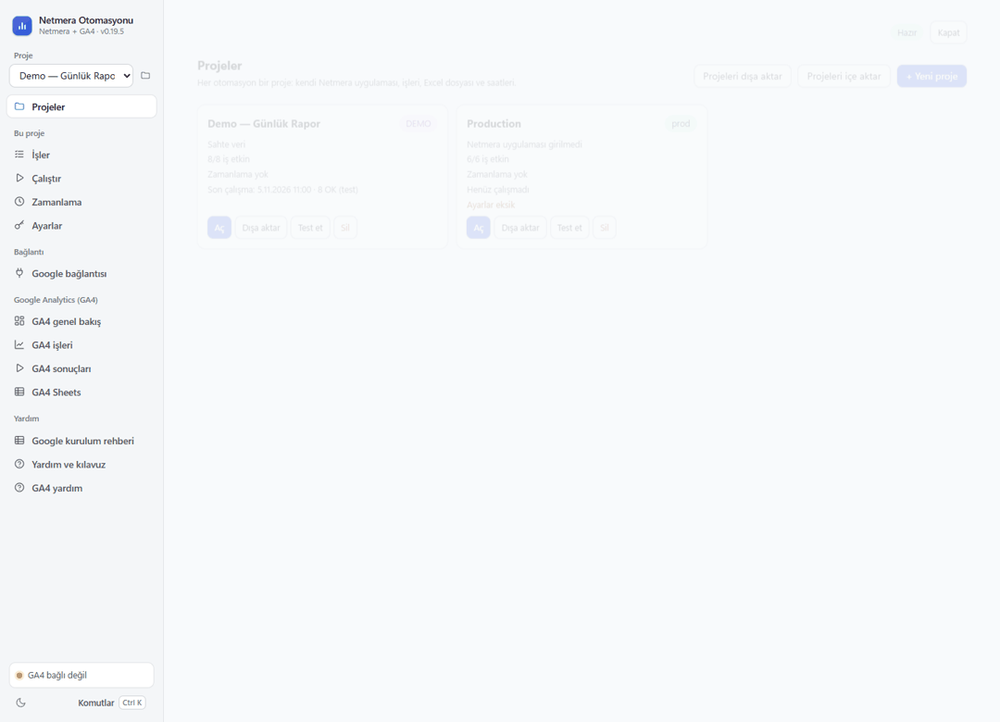
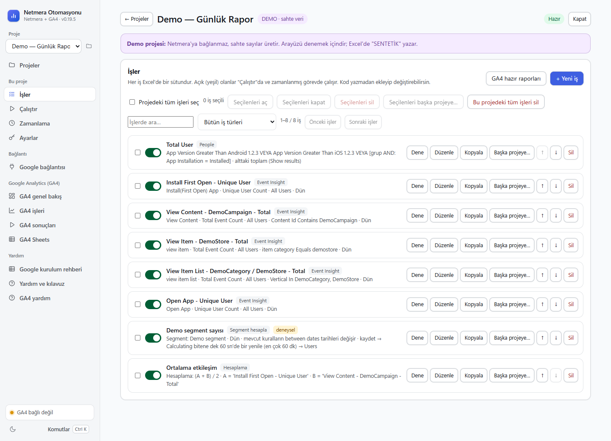
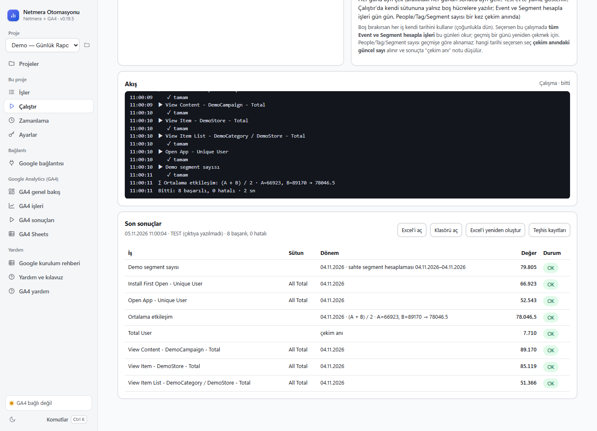
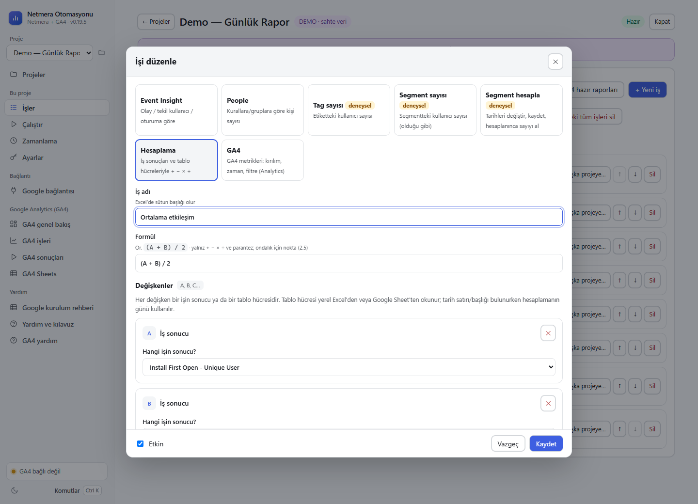
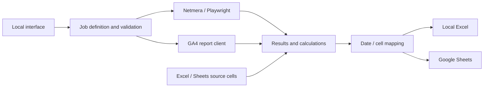

# Daily Report Automation

**Language / Dil:** [Türkçe](README.md) | English

### Combine Netmera, GA4, and spreadsheet data in one daily report.

**Daily Report Automation** is a portable Windows reporting app that brings Netmera and Google Analytics 4 (GA4) results together with existing local Excel workbooks and Google Sheets. Match each day's data to the correct date row or header, combine values from different sources with formulas, and write the result to your selected Excel workbook or Google Sheet.

**A typical workflow:** fetch Netmera/GA4 data → find the matching date in a row or header → read additional values from Excel or Google Sheets → add, subtract, multiply, divide, or average the values → write the result to local Excel or Google Sheets. Run a date range one day at a time and schedule the workflow for selected days and times.


<p align="center"></p>

> Screenshots and sample jobs use synthetic data. This repository contains no personal project settings, company reports, OAuth client, access token, or login credentials. This is an independent project and is not affiliated with Netmera.

## What it does

| Feature | Description |
|---|---|
| **Netmera reports** | Read Event Insight, People, Tag, and Segment totals |
| **Segment calculation** | Reuse existing rules, update dependent date fields in the right order, and wait for calculation to finish |
| **GA4 reports** | Create report jobs with metrics, dimensions, filters, and date settings |
| **Multiple data sources** | Combine report results with values read from existing `.xlsx` workbooks or Google Sheets cells |
| **Date and row matching** | Find the correct row in a date column or the matching day in horizontal headers |
| **Calculations** | Combine Netmera/GA4 results and Excel/Sheets cells with expressions such as `A + B`, `A - B`, `A * B`, `A / B`, or `(A + B) / 2` |
| **Excel / Sheets output** | Write results to a local Excel workbook or Google Sheets using fixed cells, date matching, or daily offsets |
| **Daily runs** | Fetch each day in a date range separately and write it to its matching cell |
| **Scheduling** | Run on selected days and times with Windows Task Scheduler |
| **Project transfer** | Export and import jobs, formulas, spreadsheet connections, cell mappings, and GA4 property mappings as JSON |

### Daily date matching with local Excel and Google Sheets

Choose an existing `.xlsx` workbook or Google Sheets page as a **source**. A formula can read a fixed cell or find the row/column for the date being processed. For example, if column A contains dates and column C contains values, the app finds the target date in column A and reads the value from column C on the same row. If dates run horizontally, it finds the matching day in the header row and reads from the corresponding column.

**Example:** A daily segment result is `25`, and cell C on the matching date row in Excel contains `5`; the formula `A + B` returns `30`. Dividing the sum of `A` and `B` by two returns `15`. The result can be written to the project's selected output, either a local Excel workbook or Google Sheets, using date matching. For local Excel, select the workbook; for Google Sheets, connect your Google account in the app. See [Google connection](GOOGLE_SHEETS.md) for setup details.

### Portable Windows package

The repository can build a single Windows ZIP containing the app, pinned dependencies, and an embedded Python runtime. Python does not need to be installed on the target computer: extract the ZIP and run `NetmeraOtomasyonu.cmd`. Chrome or Edge must be installed for Netmera panel automation. The build command is in [Development and verification](#development-and-verification).

## In the app

<p> </p>
<p> </p>

**Example:** Let a segment result be `A = 25`. Find the matching date in another spreadsheet and read `B = 5` from the same row. The formula `A + B` returns `30`; `(A + B) / 2` returns `15`. A missing, blank, or non-numeric source cell causes the calculation to fail.

## Quick start

Development requires Python 3.12 and Google Chrome or Microsoft Edge. In PowerShell:

```powershell
git clone https://github.com/AydanGelenYolcu/daily-report-automation.git
cd daily-report-automation
py -3.12 -m venv .venv
.\.venv\Scripts\python.exe -m pip install -r requirements.txt
.\NetmeraOtomasyonu.cmd
```

1. Open the **Demo (synthetic data)** project.
2. Review the jobs and select **Dene / Test et** to see synthetic results.
3. Create your project and configure report definitions, source connections, and output mappings.
4. Compare a small report with the source dashboard before scheduling it.

The app opens at `127.0.0.1`. Netmera uses a separate browser profile for automation; connect Google from within the app. Docker is not required.

### Run options

```powershell
# Local interface
.\.venv\Scripts\python.exe -m netmera_automation ui

# List projects
.\.venv\Scripts\python.exe -m netmera_automation profiller

# Run the synthetic demo
.\.venv\Scripts\python.exe -m netmera_automation run --profile demo-sahte-veri
```

## How it works



| File / folder | Responsibility |
|---|---|
| `netmera_automation/server.py` | Local HTTP interface and background jobs |
| `jobs.py`, `runner.py` | Job definitions, validation, and execution order |
| `panel.py`, `ga4/` | Read data from sources |
| `formula.py`, `cell_mapping.py` | Calculations and output placement |
| `ui/src/`, `tools/build_ui.py` | UI sources and generated combined HTML |
| `tests/` | Synthetic data and mock-panel checks |

## Technologies, languages, and APIs

GitHub automatically identifies **Python, HTML, and Batchfile** from the repository's source files. The interface also uses CSS and JavaScript embedded in HTML.

| Area | Technology / API | Use |
|---|---|---|
| App | Python 3.12 | Jobs, scheduling, formulas, and data transfer |
| Interface | HTML, CSS, JavaScript | Local web interface served at `127.0.0.1` |
| Netmera | Playwright + installed Chrome/Edge | Reads report results through the Netmera web panel; no Netmera REST API integration is claimed |
| Google Analytics 4 | Google Analytics Data API v1beta | Read-only GA4 report queries |
| GA4 properties | Google Analytics Admin API v1beta | Lists accessible account and property summaries |
| Google Sheets | Google Sheets API v4 | Reads source cells and writes mapped report cells |
| Google connection | OAuth 2.0 desktop flow | Grants Analytics and Sheets access; the session is protected locally with Windows DPAPI |
| Local spreadsheets | `openpyxl`, `.xlsx` | Reads source cells and writes output to a selected workbook |
| Portable launcher | Windows Batchfile (`.cmd`) | Starts the app from a ZIP with embedded Python |

## Stability and data privacy

- Large job lists are paginated; search covers all jobs.
- A delayed request from an old project cannot override the latest project selection. A single-job toggle only saves that job.
- Status polling does not repeatedly transfer full reports; large results are loaded separately.
- GA4 report jobs are not added automatically at startup; use the update button to start that action.
- Formulas are evaluated with an allowlisted expression tree; arbitrary code is not executed.
- Login credentials are protected with Windows DPAPI for the current user. Sessions and user reports are not committed to Git.

[Google connection](GOOGLE_SHEETS.md) · [Security and privacy](SECURITY.md)

## Development and verification

```powershell
# Rebuild the UI after changing its sources
.\.venv\Scripts\python.exe tools\build_ui.py

# Transfer, stability, and formula tests
.\.venv\Scripts\python.exe -m unittest tests.test_project_transfer tests.test_ui_stability tests.test_formula

# Build a portable Windows ZIP
.\.venv\Scripts\python.exe tools\build_portable.py
```

Browser tests use installed Chrome; mock-panel requests are handled locally. Demo and test results do not prove live Netmera or Google access. Recheck the relevant reading flows when the panel interface or account permissions change.
