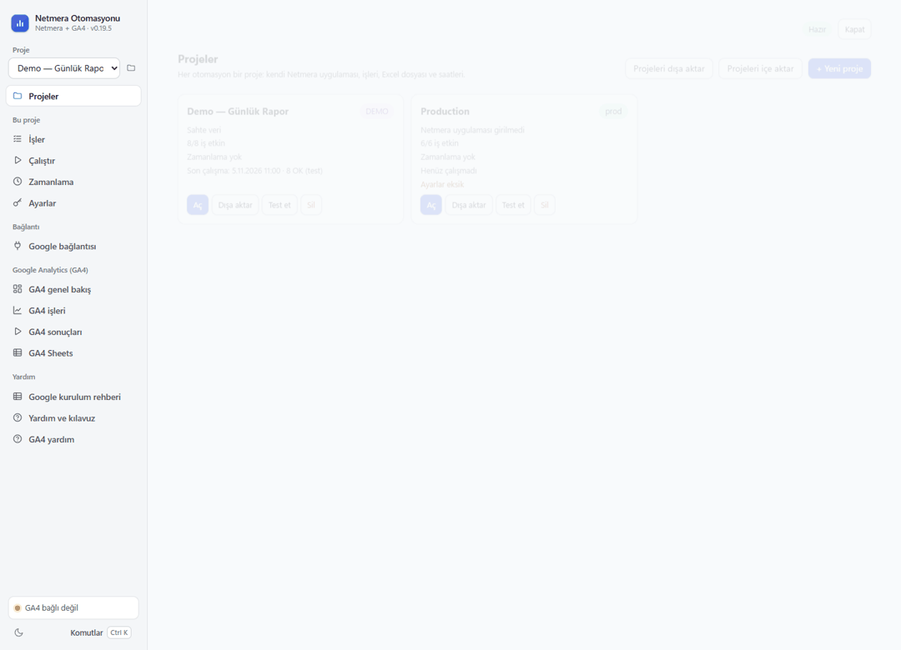
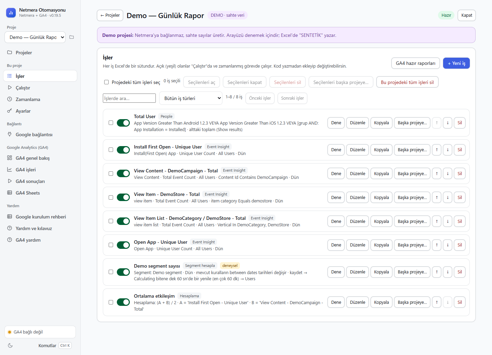
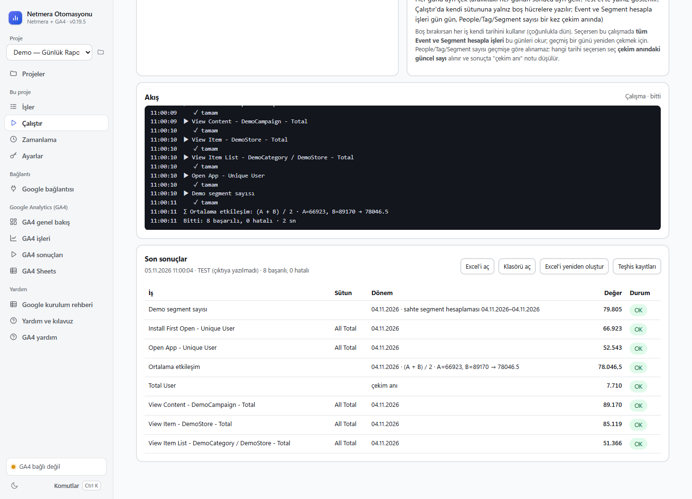
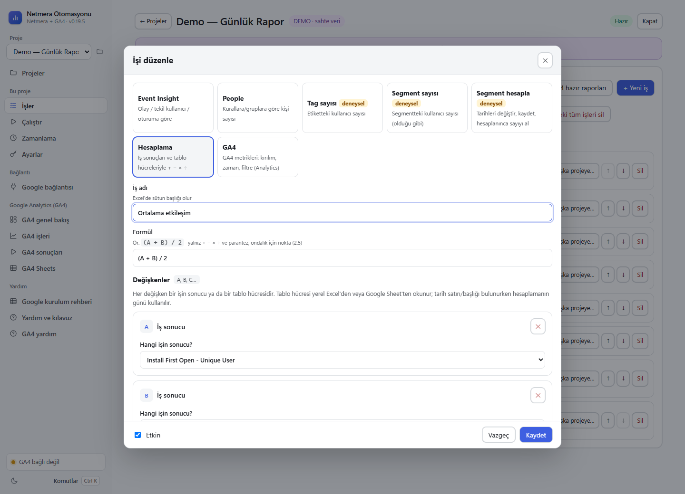
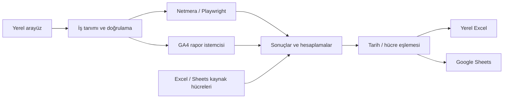

# Daily Report Automation

### Günlük raporları tek akışta hazırlayın ve aktarın.

**Daily Report Automation**, günlük analitik raporlarını hazırlama ve tablolara aktarma işini otomatikleştiren bir Windows uygulamasıdır. Netmera ve Google Analytics 4 verilerini tanımlı gün ve saatlerde çekin; Excel veya Google Sheets hücrelerine eşleyin, farklı kaynaklardan gelen sayılarla hesaplama yapın ve aynı rapor akışını tekrar kullanın.


<p align="center"></p>

> Görseller ve örnek işler tamamen sentetiktir. Depo kişisel proje ayarı, şirket raporu, OAuth istemcisi, erişim belirteci veya giriş bilgisi içermez. Netmera ile resmî bir bağlantısı olmayan bağımsız bir projedir.

## Neler yapar?

| İşlem | Kullanım |
|---|---|
| **Netmera raporları** | Event Insight, People, Tag ve Segment toplamlarını okuma |
| **Segment hesaplama** | Mevcut kuralları kullanma, bağlı tarih kutularını uygun sırada değiştirme, hesaplamayı bekleme |
| **GA4 raporları** | Metrik, kırılım, filtre ve tarih tanımıyla rapor işleri oluşturma |
| **Excel / Sheets eşleme** | Sabit hücre, tarih satırı, tarih başlığı veya günlük kayma ile hedef bulma |
| **Hesaplamalar** | İş sonuçları ve farklı Excel/Sheets hücreleriyle `(A + B) / 2` gibi ifadeler |
| **Gün gün çalışma** | Tarih aralığındaki günleri ayrı çekme ve kendi hücrelerine yazma |
| **Zamanlama** | Windows Görev Zamanlayıcı üzerinden seçilen gün/saatlerde çalıştırma |
| **Proje aktarımı** | İşleri, formülleri, tablo bağlantılarını, hücre ve GA4 mülk eşlemelerini JSON ile taşıma |

## Uygulama içinde

<p> </p>
<p> </p>

**Örnek akış:** Segment sonucu `A = 25` olsun. Başka bir tablonun tarih sütununda ilgili günü bulup aynı satırdaki `B = 5` değerini alın. `A + B` ifadesinin sonucu `30`; `(A + B) / 2` ifadesinin sonucu `15` olarak hedef hücreye yazılır. Boş, bulunamayan veya sayı olmayan kaynak hücrede hesaplama hata verir.

## Hızlı başlangıç

Geliştirme için Python 3.12 ve Google Chrome veya Microsoft Edge kullanılır. PowerShell:

```powershell
git clone https://github.com/AydanGelenYolcu/daily-report-automation.git
cd daily-report-automation
py -3.12 -m venv .venv
.\.venv\Scripts\python.exe -m pip install -r requirements.txt
.\NetmeraOtomasyonu.cmd
```

1. **Demo (sahte veri)** projesini açın.
2. İşleri inceleyin ve **Dene / Test et** ile sentetik sonuçları görün.
3. Kendi projenizi oluşturup rapor tanımı, kaynak bağlantısı ve çıktı eşlemelerini seçin.
4. Gerçek kaynakta küçük bir raporu panelle karşılaştırdıktan sonra zamanlamayı kurun.

Uygulama arayüzü `127.0.0.1` üzerinde açılır. Netmera için ayrı otomasyon tarayıcı profili kullanılır; Google bağlantısı uygulama içinden kurulur. Docker gerekmez.

### Çalıştırma seçenekleri

```powershell
# Yerel arayüz
.\.venv\Scripts\python.exe -m netmera_automation ui

# Projeleri listele
.\.venv\Scripts\python.exe -m netmera_automation profiller

# Sentetik demo çalışması
.\.venv\Scripts\python.exe -m netmera_automation run --profile demo-sahte-veri
```

## Nasıl çalışır?



| Dosya / klasör | Sorumluluk |
|---|---|
| `netmera_automation/server.py` | Yerel HTTP arayüzü ve arka plan görevleri |
| `jobs.py`, `runner.py` | Tanımlar, doğrulama ve çalışma sırası |
| `panel.py`, `ga4/` | Kaynaklardan veri okuma |
| `formula.py`, `cell_mapping.py` | Hesaplamalar ve çıktı yerleşimi |
| `ui/src/`, `tools/build_ui.py` | Arayüz kaynakları ve birleşik HTML üretimi |
| `tests/` | Sentetik veri ve sahte panellerle doğrulama |

## Kararlılık ve veri güvenliği

- Kalabalık iş listeleri sayfalanır; arama tüm işlerde çalışır.
- Eski proje istekleri yeni seçimi geri çeviremez. Tek iş anahtarı yalnız o işi kaydeder.
- Durum yoklaması tam raporu tekrar tekrar taşımaz; büyük sonuçlar ayrıca yüklenir.
- Açılışta yeni GA4 rapor işi otomatik eklenmez; kullanıcı güncelleme düğmesiyle başlatır.
- Formüller izin verilen ifade ağacıyla değerlendirilir; serbest kod çalıştırılmaz.
- Giriş bilgileri Windows DPAPI ile kullanıcı hesabına bağlı saklanır. Oturumlar ve kullanıcı raporları Git'e girmez.

[Google bağlantısı](GOOGLE_SHEETS.md) · [Güvenlik ve gizlilik](SECURITY.md)

## Geliştirme ve doğrulama

```powershell
# Arayüz kaynakları değişince
.\.venv\Scripts\python.exe tools\build_ui.py

# Aktarım, kararlılık ve hesaplama testleri
.\.venv\Scripts\python.exe -m unittest tests.test_project_transfer tests.test_ui_stability tests.test_formula

# Taşınabilir Windows ZIP'i üret
.\.venv\Scripts\python.exe tools\build_portable.py
```

Tarayıcı testleri kurulu Chrome'u kullanır; sahte panel istekleri yerelde karşılanır. Demo ve test sonuçları canlı Netmera/Google erişiminin doğrulandığı anlamına gelmez. Panel arayüzü veya hesap izinleri değiştiğinde ilgili okuma adımlarının yeniden kontrol edilmesi gerekir.
